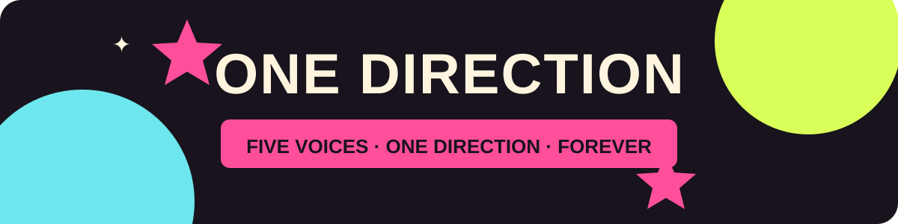

# One Direction Fanpage ✦

Fanpage maximalista feita como atividade de introdução à criação de páginas web. O projeto apresenta a trajetória do One Direction em uma página responsiva, com visual colorido inspirado na estética pop e nostálgica do fandom.



## Sobre a atividade

A proposta da aula era criar uma página web funcional do zero usando **HTML e CSS em um único arquivo**, com apoio de Inteligência Artificial para estruturar o código e o conteúdo. O tema escolhido foi uma fanpage do One Direction.

## O que a página inclui

- Cabeçalho fixo e navegação por seções.
- Apresentação da banda e resumo de sua formação.
- Cards dos integrantes, discografia e links para buscar os álbuns no Spotify.
- Vídeo oficial de “What Makes You Beautiful” incorporado do YouTube.
- Galeria de fotos, easter eggs e detalhes animados em CSS.
- Layout adaptado para telas menores.
- Fotos incorporadas diretamente no HTML para que não dependam de hosts de imagem externos.

## Como abrir

1. Baixe ou clone este repositório.
2. Abra o arquivo `index.html` em um navegador atualizado.
3. Para assistir ao vídeo incorporado, conecte-se à internet.

Não é necessário instalar programas, dependências ou servidor local.

## Tecnologias

- HTML5
- CSS3
- Incorporação de vídeo do YouTube

## Estrutura

```text
.
├── index.html
├── README.md
└── assets/
    └── 1d-animated-banner.svg
```

## Créditos e observações

Esta é uma fanpage feita para fins educacionais e não possui vínculo oficial com o One Direction. Os fatos sobre a banda foram consultados no site da [Sony Music](https://www.sonymusic.co.uk/artist/one-direction/) e no [site oficial de música do One Direction](https://www.onedirectionmusic.com/gb/music/albums/up-all-night/videos). As imagens são de terceiros e estão incorporadas no arquivo HTML; os créditos e a origem indicada estão no rodapé da página. O vídeo é carregado do YouTube e precisa de internet.

## Feito para a aula

Projeto individual de criação web com HTML e CSS, explorando estrutura semântica, estilos, links, mídia incorporada, responsividade e criatividade visual.
